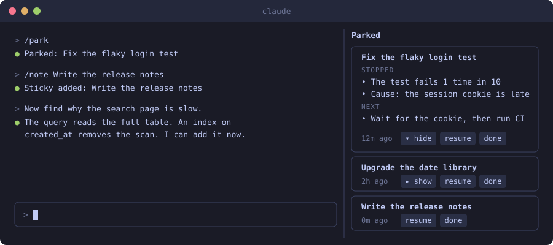
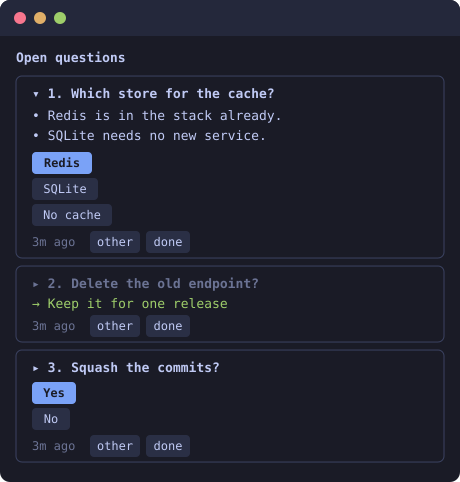

# stickies

A Claude Code mod that adds two side panes to the terminal:

- **Parked**: sticky notes for work that you put aside.
- **Open questions**: the questions that Claude asked and you did not answer.



The images on this page are drawings of the panes, not screenshots. Colors and button shapes follow your terminal theme.

## Why

During a long session a new request arrives, and you start to work on it. The work that you did before is then easy to forget. The same happens to questions. Claude asks five things in one reply, you answer one, and the other four are lost in the scroll.

`stickies` keeps the two lists in view.

## Install

You need Claude Code with function hooks. That API is in early access.

In a Claude Code terminal session:

```
/plugin marketplace add siarhei-kaliaha/claude-stickies
/plugin install stickies@claude-stickies
```

Or from a shell:

```
claude plugin marketplace add siarhei-kaliaha/claude-stickies
claude plugin install stickies@claude-stickies
```

Start a new session after the install. The Parked pane opens at the start of each session.

To run the mod from a local folder without an install:

```
git clone https://github.com/siarhei-kaliaha/claude-stickies.git
claude --plugin-dir ./claude-stickies
```

## Use

### Parked work

| You do | Result |
| --- | --- |
| `/park` | Claude writes a sticky: the work, the point where it stopped, the next step. |
| `/note some text` | A sticky with your text. |
| `/stickies` | Opens the Parked pane. |
| Press `▸ show` on a sticky | The sticky shows the STOPPED and NEXT text. Press `▾ hide` to close it. |
| Press `resume` on a sticky | The text of the sticky replaces the text in the prompt box. Press Enter to continue that work. |
| Press `done` on a sticky | The sticky is removed. |

A sticky with the same name replaces the old one. When there are more than 7 stickies, the oldest ones get a warning color.

You can also ask in plain words: "park this" or "put this on a sticky".

### Open questions



Claude keeps this list itself. When a reply has a question that only you can answer, Claude sends the full list of open questions to the pane. When you answer a question, Claude removes it.

Each question has:

- a one-line summary,
- details that you expand with the `▸` button,
- 2 to 4 answer buttons. The first one is the answer that Claude recommends.

| You do | Result |
| --- | --- |
| Press an answer button | The question and your answer go into the prompt box. You can answer more questions, then press Enter one time. |
| Press `other` | The question goes into the prompt box, and you type your own answer. |
| Press `done` | The question is removed. |
| `/questions` | Opens the Open questions pane. |

## How it works

`stickies` is a plugin of function hooks. It has no dependencies and no build step.

| File | Purpose |
| --- | --- |
| `hooks/register.tsx` | The hooks module. It registers the 4 commands, the 2 panes, and 2 tools for Claude: `park` and `open_questions`. |
| `types/index.d.ts` | The state contract. |
| `tests/stickies.test.ts` | Tests that run with `claude plugin test`. |
| `.claude-plugin/` | The plugin manifest and the marketplace manifest. |

The hooks module also adds one section to the system prompt. That section tells Claude when to update the questions.

Each session has its own stickies and its own questions. The data is in the plugin store of Claude Code on your machine. The plugin sends nothing to a network.

## Limits

- The function hooks API of Claude Code is in early access and can change between releases. This mod was written and tested with Claude Code 2.1.292.
- A pane that opens without a command from you needs a terminal that is at least 144 columns wide. A pane that you open with `/stickies` or `/questions` opens at any width.
- The Open questions list depends on Claude. If Claude does not call the tool, a question does not appear. You can then say "add that to open questions".

## Develop

```
claude plugin validate .
claude plugin test .
```

## License

MIT
